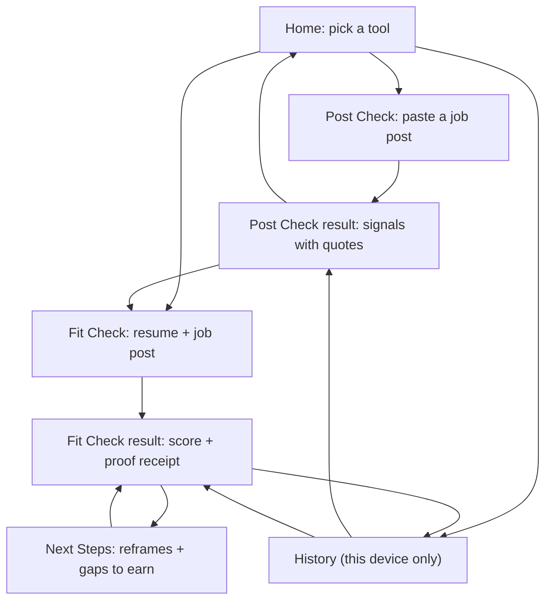

# App flow

Screens, paths between them, and what each state shows. Derived from `PRODUCT.md`, `ARCHITECTURE.md` and `REQUIREMENTS.md`; where this file disagrees with `REQUIREMENTS.md`, the requirements win. Mobile first (360 px, NFR-13).

Clickable visual prototype: [`design/prototype/index.html`](../design/prototype/index.html), with a [style guide](../design/prototype/style-guide.html) and an [error-states page](../design/prototype/states.html).

## Screen map

Navigation is flat: a tool bar on every screen (Post Check, Fit Check, History). No accounts, no sign-in, no onboarding.

## Principles that shape every screen

1. **Proof first.** Anything the app claims shows its quote next to it. A claim with no verified quote is not shown as a claim; it appears as a rejected line.
2. **Signals, never verdicts.** Post Check says "signals found", never "this is a scam" (AGENTS.md #14). No signals found means "none of our checks fired", not "safe".
3. **Say what is stored.** Every input screen states that nothing is saved on a server. History lives in the browser.
4. **Degrade visibly.** If the AI is unavailable the deterministic parts still work and the screen says what is missing.

## Home

| Element | Behavior |
|---|---|
| Three tool entries | Post Check, Fit Check, History. One line on what each does |
| Privacy line | "Your resume and job posts are not saved on our server." |
| API status | Small, quiet. Shows "waking up" on a cold start (Render free tier sleeps), then clears |

## Post Check (FR-17, FR-18, FR-19)

**Input:** one text area for the job post. Paste only (no file). Character limit with a live counter. Button: Check this post.

**Flow:** paste → check → rule engine runs (no LLM) → result. If the AI is available, an optional "Explain in plain language" control appears (English or Taglish).

**Result:**
- Header: how many signals were found, wording kept neutral.
- Each signal: label, the exact quote from the post (highlighted in the post text), and a one-line reason.
- A fixed note: "Signals are not a verdict. Check the employer through official channels." Official channel links come from Q-12 (not yet verified, so none are shown until they are).
- Zero signals: "None of our checks fired. This does not mean the post is safe."
- Actions: Check another, Save to history (automatic, local), Use this post in Fit Check.

| State | Shows |
|---|---|
| Empty input | Button disabled, hint to paste the post |
| Too long | Counter turns to an error, button disabled |
| Checking | Short progress state; rules are fast |
| AI explain unavailable | Signals still shown; "AI explanation unavailable" where the explanation would be |
| API unreachable / waking | "Waking up the server, this can take about a minute", retry automatic |

## Fit Check (FR-01 to FR-11, FR-15)

**Input:** resume (PDF or DOCX upload, or paste text) and the job post (paste). Button: Check my fit.

**Flow:** upload/paste → analyze → parse → requirements extracted → matched → quotes verified → score → result. Up to 3 AI calls (NFR-12); target under 60 seconds on the demo.

**Result (the "proof receipt"):**
- Fit score, large, with the line that it is computed by code, not by the AI.
- Requirements grouped Strong, Partial, Gap. Required items listed before preferred.
- Each requirement: the requirement text, the rating, and the resibo: the resume quote, highlighted, with a verified mark.
- A rejected claim shows a distinct "AI claim rejected, no proof found" line and counts as a Gap. This is a feature and is shown, not hidden.
- Resume hygiene notes (FR-20): advice, worded as context-dependent, collapsed by default.
- Actions: Next Steps, Check another, back to Post Check for the same post.

| State | Shows |
|---|---|
| No file and no pasted text | Button disabled |
| Unreadable or image-only PDF | "We can't read this file." Suggest DOCX or pasting the text. No OCR (DECISIONS #26) |
| Oversized file or text | Plain message with the limit (API returns 413) |
| Analyzing | Step-by-step progress (reading resume, finding requirements, checking proof). Cancel button |
| AI unavailable or quota out | Deterministic result only, with an explicit "AI explanation unavailable" state |
| Some steps failed | Partial result, with the failed step named |
| Rate limited (429) | "Too many checks, try again in a few minutes" |

## Next Steps (FR-10)

Two separate lists, never mixed:
1. **Reframe what you already have.** Tips that reuse only verified experience, each with its quote.
2. **Gaps you could earn.** Honest actions for missing items, labeled "Not on your resume". These are not claims about the user.

## History (FR-23)

- Stored in the browser only (IndexedDB). A banner says so.
- List of past Post Checks and Fit Checks: date, type, short title (job title if found), score or signal count.
- Open an entry to see its saved result. Delete one, or clear all.
- Resume text is not stored in history; only the result, which contains the verified quotes (privacy-reviewed in M5, open item).
- Empty state: "Nothing saved on this device yet."

## Cross-cutting states

| Situation | Behavior |
|---|---|
| Offline (PWA) | App shell loads; checks need the network, so the button explains that |
| First load on a cold server | "Waking up" state, no error |
| Any server error | Same error shape everywhere: a short message from the API's `error.message`, never raw internals |
| Prompt-injection text in a resume or post | Treated as data; no special UI (NFR-09) |

## What is sent and stored

| Data | Sent to server | Stored |
|---|---|---|
| Job post text | Yes, for the check | Not stored, not logged (NFR-10) |
| Resume file or text | Yes, for the check | Not stored, not logged |
| Results | Returned to the browser | Browser only (IndexedDB) |
| Usage metadata (model, latency, success) | Logged server-side | Metadata only, no text |

## Requirement map

| Area | Requirements |
|---|---|
| Post Check screens | FR-17, FR-18, FR-19, NFR-15 |
| Fit Check screens | FR-01 to FR-11, FR-15, FR-20 |
| History | FR-23 |
| Mobile and size | NFR-13 |
| Error states | NFR-04 |
| Privacy statements | NFR-10 |

## Open items

- Official verification channels to link from Post Check (Q-12).
- Whether history may store resume-derived quotes at all, or only scores and signal counts (decide in M5 with the privacy notes).
- Tool names and tab labels in Filipino/English; decide when the visual design settles.
